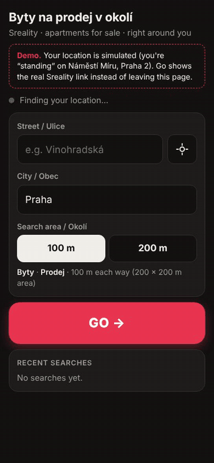

# Byty v okolí: Apartment Lookup

One tap from where you're standing to **Sreality apartments for sale right around you**: 100 or 200 m.
It's a single HTML file, [`index.html`](index.html), with no framework, no build step and no server code.

<p align="center">
  
</p>

## Try it

| | Link | What runs |
|---|---|---|
| **Live demo** | [claude.ai/artifact/FjGmnSJ3sfeQQxfqMVdLh5](https://claude.ai/artifact/FjGmnSJ3sfeQQxfqMVdLh5) | Simulated location; Go shows the real Sreality link |
| **Demo on your site** | `https://<your-site>/#demo` | The same demo, from this repo |
| **Real app** | `https://<your-site>/` | Real GPS, OpenStreetMap, then straight to Sreality |

The live demo is private until you share it from its Share menu.

## Screens


## How it works

1. **Where you are.** The phone's GPS gives your position, and [OpenStreetMap Nominatim](https://nominatim.openstreetmap.org) names the street and city. Both fields stay editable, and the city defaults to *Praha*.
2. **Typed street.** If you type a different street, OpenStreetMap finds its coordinates. With GPS on, the match nearest to you wins.
3. **Size.** Choose 100 m (the default) or 200 m each way from the centre. The page remembers your choice.
4. **Go.** The page opens Sreality with that square as a map area:
   ```
   https://www.sreality.cz/hledani/prodej/byty?lat-max=<north>&lat-min=<south>&lon-max=<east>&lon-min=<west>
   ```
5. **Recent searches.** The last 5 are kept in the browser. Tap one to repeat it.

Sreality's own "street + distance" search needs its internal street number, which browsers can't fetch from another site. A map area needs no lookup, so the page works as a plain HTML file. The comment at the top of `index.html` explains the URL format in case Sreality changes it.

## Publish it

Upload `index.html` to any web hosting that serves **HTTPS**. Phones only share location with HTTPS pages. Nothing else is needed: no PHP, no database, no API keys.

- **Your own hosting:** upload it over FTP or the file manager, e.g. as `byty/index.html`, and open `https://<your-domain>/byty/`.
- **GitHub Pages, free:** Settings → Pages → *Deploy from a branch* → `main`, `/ (root)`. It's then at `https://<user>.github.io/apartment-lookup/`.

## Add to home screen

- **iPhone:** Safari → Share → *Add to Home Screen*.
- **Android:** Chrome → ⋮ → *Add to Home screen*.

The icon is generated by the page itself, so nothing else needs to be hosted.

## Demo mode

Add `#demo` to the URL. It simulates standing on náměstí Míru, Praha 2, and knows a few streets (náměstí Míru, Vinohradská, Žitná, Kotlářka). Go shows the Sreality link instead of leaving the page. The links are real and open real results.
