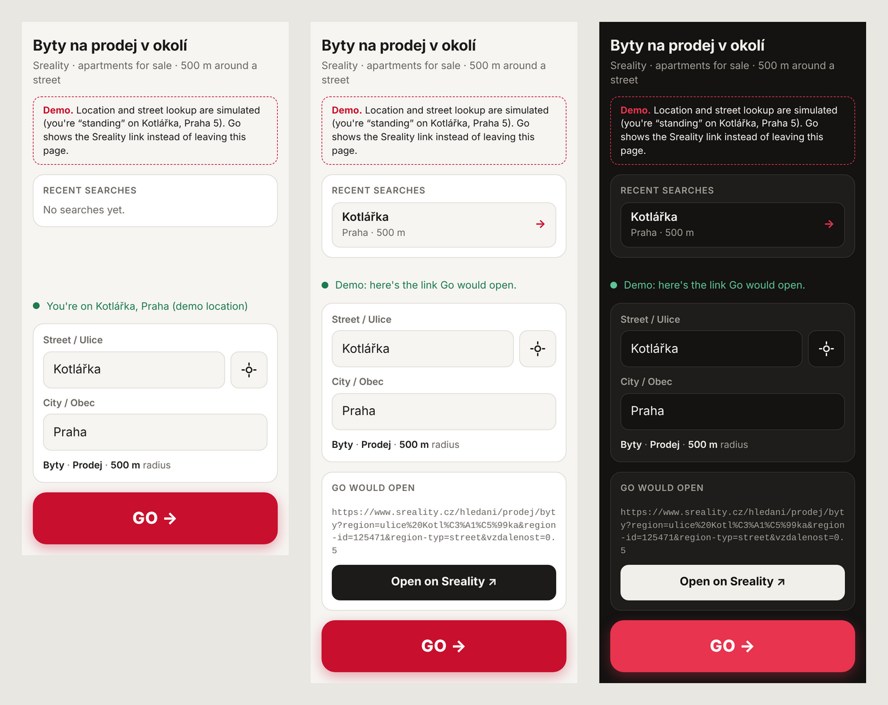

# Byty v okolí: Sreality street lookup

One tap from where you're standing to **Sreality apartments for sale within 500 m**.
It's a single HTML file, [`index.html`](index.html), with no framework and no build step.

<p align="center">
  
</p>

## Try it

| | Link | What runs |
|---|---|---|
| **Live demo** | [claude.ai/artifact/FjGmnSJ3sfeQQxfqMVdLh5](https://claude.ai/artifact/FjGmnSJ3sfeQQxfqMVdLh5) | Demo mode: simulated location and lookup; Go shows the link |
| **Demo on your site** | `https://<your-site>/#demo` | Same demo mode, from this repo |
| **Real app** | `https://<your-site>/` | Real GPS, OpenStreetMap and Sreality redirect (needs HTTPS and the proxy below) |

The live demo is private until you share it from its Share menu.

## Screens



## How it works

1. **Location.** The browser's geolocation finds you, and [Nominatim](https://nominatim.openstreetmap.org) turns the coordinates into a street and city. Both stay editable, and the city defaults to *Praha*.
2. **Street ID.** Sreality's radius search needs its own numeric street ID, so the page asks Sreality's autocomplete for it. It picks the match in your city that's closest to you.
3. **Go.** The page opens:
   ```
   https://www.sreality.cz/hledani/prodej/byty?region=ulice%20<Street>&region-id=<id>&region-typ=street&vzdalenost=0.5
   ```
4. **Recent searches.** The last 5 searches are kept in `localStorage`. Tap one to repeat it.

## The one setup step: a small proxy

Sreality's autocomplete endpoint (`/api/v1/localities/suggest`) blocks calls from web pages on other sites (it sends no CORS headers). The page is static, so a free **Cloudflare Worker** does that one call:

1. Create a free account at [dash.cloudflare.com](https://dash.cloudflare.com).
2. Go to **Workers & Pages → Create → Create Worker**, name it e.g. `sreality-suggest`, and click **Deploy**.
3. Click **Edit code**, replace everything with [`cloudflare-worker.js`](cloudflare-worker.js), and set `ALLOWED_ORIGIN` to your site's address, e.g. `https://www.example.cz` (no trailing slash).
4. Click **Deploy** and copy the Worker's address, e.g. `https://sreality-suggest.yourname.workers.dev`.
5. In `index.html`, put that address into `var SUGGEST_PROXY = "";` and upload the file again.

The Worker only calls Sreality's street lookup and only answers your own site. Nothing runs on your web hosting.

Without the proxy, Go offers a search across the whole city with no radius, and the page says so on screen first.

## Hosting

Any static HTTPS host works, because the page is one file (`index.html`); the Worker runs on Cloudflare. The free option is **GitHub Pages**: in this repo, go to Settings → Pages, choose *Deploy from a branch*, then pick `main` and `/ (root)`. The app is then at `https://<user>.github.io/apartment-lookup/`. Location only works over HTTPS, which Pages provides.

## Add to home screen

- **iPhone:** Safari → Share → *Add to Home Screen*.
- **Android:** Chrome → ⋮ → *Add to Home screen*.

The icon is generated by the page itself, so nothing else needs to be hosted.

## Demo mode

Add `#demo` to the URL. It fakes standing on Kotlářka, Praha 5, and its street ID (125471) comes from a public Sreality link. Go shows the link instead of leaving the page. Any other street shows the "no street ID" notice, as the real app does when the lookup fails.
